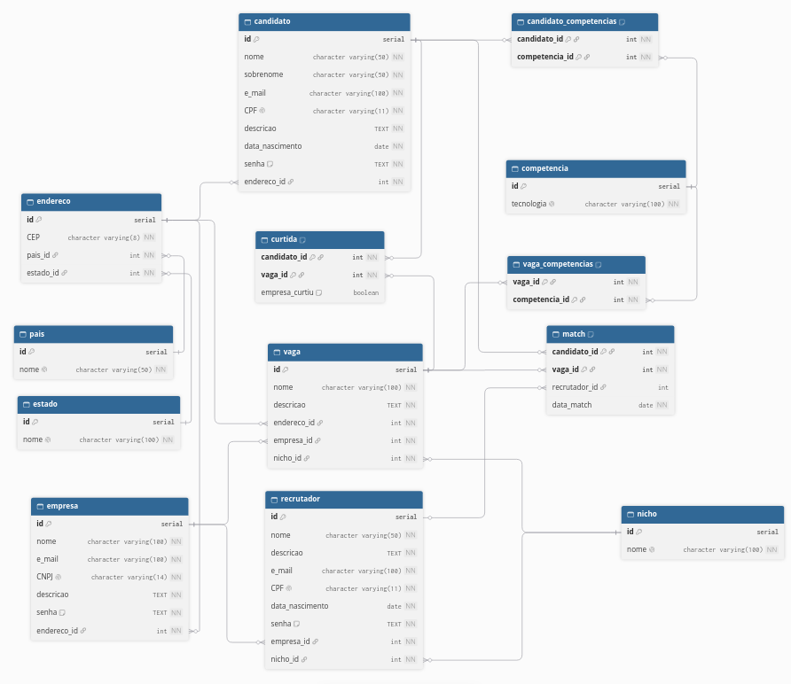

### Sobre:

Esté é uma aplicação que mistura o Linkedin com o Tinder, para facilitar o processo de recrutamento.
## BACKEND:

### Para executar:
    1. Crie um banco de dados PostgreSQL nomeado 'linketinder'
    2. Utilize o script de criação em banco_de_dados/schema_com_populacao.sql para criar as tabelas e popular o banco.
    3. Execute na raiz do projeto o seguinte comando:

        ./gradlew run -q --console=plain

    ALTERNATIVAMENTE

    4. Abra o projeto no Intellij IDEA.
    5 Vá para src/main/groovy/org/linketinder/Main.groovy e clique no botão RUN do método main()

## FRONTEND:

### Para executar:

    1. Vá para frontend/
    2. Execute o seguinte comando:

        npm run this

    3. Em um navegador, vá para o endereço "network" fornecido:

        ┌───────────────────────────────────────────┐
        │                                           │
        │   Serving!                                │
        │                                           │
        │   - Local:    http://localhost:3000       │
        │   - Network:  http://192.168.0.227:3000   │  <- esse endereço
        │                                           │
        │   Copied local address to clipboard!      │
        │                                           │
        └───────────────────────────────────────────┘
         
## BANCO DE DADOS:

## Sistema de curtidas:

Funciona por meio da tabela "curtida" no banco de dados, onde é feita uma chave primaria composta pelo ID do candidato e o ID da vaga (já que o candidato é aquele quem inicia o processo de match).
Quando a empresa dona da vaga quer fazer o match, é trocado o valor de "empresa_curtiu" na tabela de falso para verdadeiro.

## Índice de afinidade:

O frontend do projeto conta com um sistema de índice de afinidade, tanto para candidatos quanto para empresas.

Como candidato, ao acessar a listagem de vagas, o sistema conta quantas das competencias desejadas da vaga o candidato tem para mostrar um índice de afinidade.

Como empresa, ao acessar a listagem de candidatos, o sistema cria um mapa simples de todas as ocorrências de competências desejadas de suas vagas para mostrar uma "afinidade global" com o candidato. (Um candidato que sabe groovy terá afinidade maior em uma empresa que possui 3 vagas que buscam por groovy do que uma empresa que possui apenas 1 vaga que busca por groovy)

## Informações pertinentes:

1. Frontend feito com Typescript + HTML, com o uso da biblioteca [chart.js](https://www.chartjs.org/)
2. Frontend ainda é completamente independente do backend.
3. Banco de dados feito com PostgreSQL
4. Modelo DER feito com [dbdiagram](https://dbdiagram.io/home)